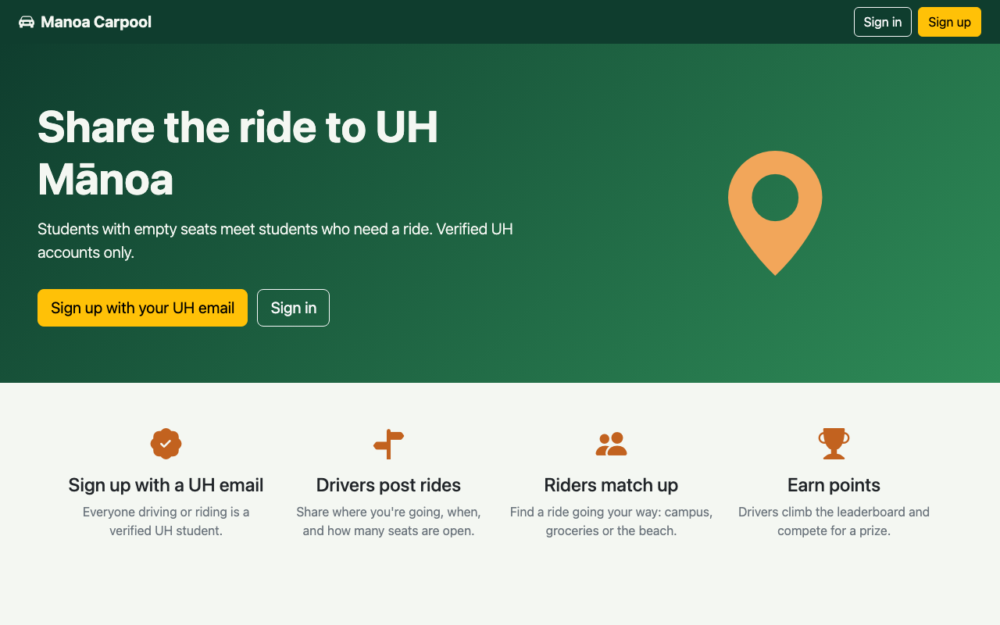
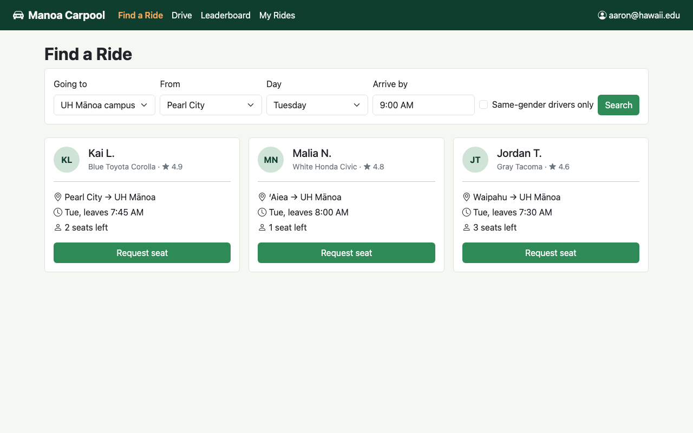
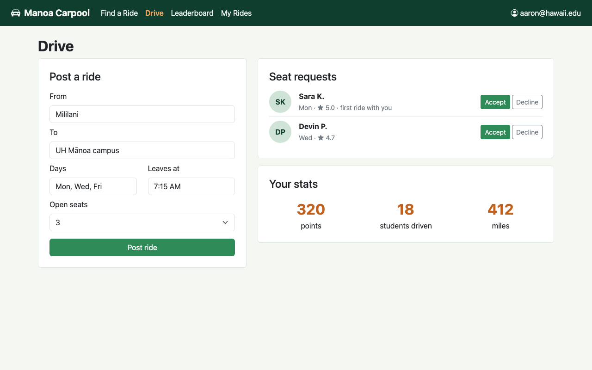
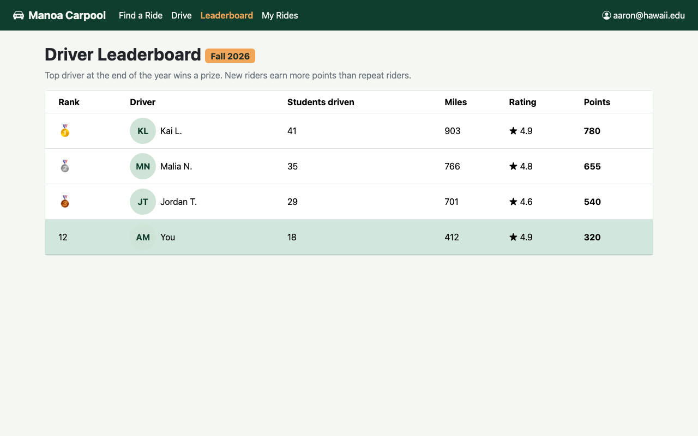
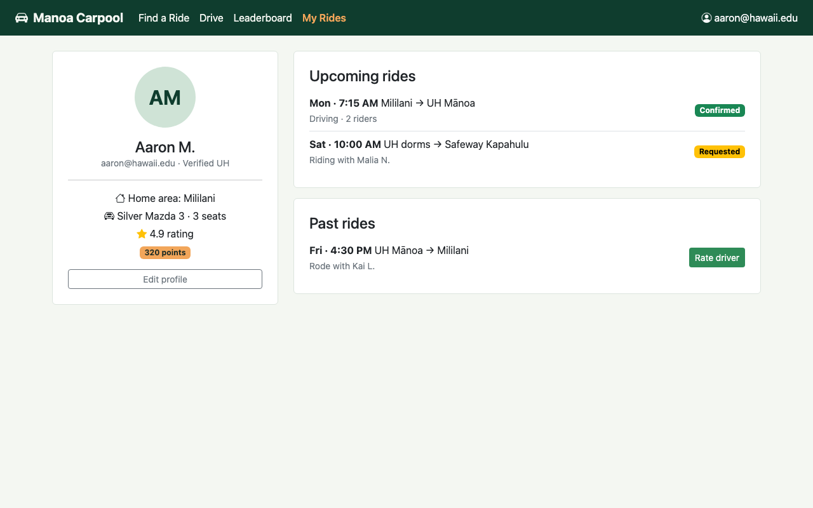
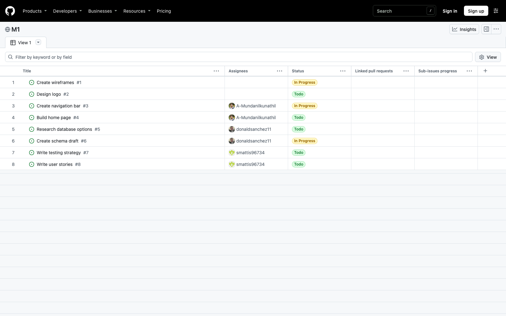

# Manoa Carpool

* [Overview](#overview)
* [Deployment](#deployment)
* [User Guide](#user-guide)
* [Community Feedback](#community-feedback)
* [Developer Guide](#developer-guide)
* [Development History](#development-history)
* [Team Contract](#team-contract)
* [Team](#team)
* [Contact Us](#contact-us)

## Overview

**The problem.** Getting to UH Manoa is a daily headache. Parking passes are expensive and hard to get, the structures fill up early, and the bus can add an hour to a commute from Kapolei, Kaneohe, or Hawaii Kai. At the same time, hundreds of students drive to campus alone every day from the same neighborhoods at roughly the same times. There is no easy way to find them, and no way to know whether a stranger offering a ride is actually a UH student.

**The solution.** Manoa Carpool is a ride-matching app just for the UH Manoa community. Everyone signs up with a verified UH email. Drivers post where they are going, when, and how many seats are open. Riders search for rides going the same way, whether that is to campus, the grocery store, or the beach, and request a seat.

**What makes it different.** Drivers earn points for every confirmed ride, with more points for new riders than for driving the same person again, and climb a leaderboard toward an end-of-year prize. Riders get UH verification, driver ratings, reports, and an optional same-gender ride preference. Each user's schedule, home area, car, preferences, rating, and points shape what they see when they log in.

**Built with:** Next.js, React, Bootstrap 5, PostgreSQL with Prisma, and Vercel.

## Deployment

The app will be deployed to Vercel for Milestone 1. The link will go here once it is live.

## User Guide

These are the mockups for Milestone 1. They show the pages we are building.

### Landing page

New visitors learn what Manoa Carpool is and can sign up with their UH email or sign in.

### Find a Ride (passenger page)

Riders search by destination, starting area, day, and arrival time, can limit results to same-gender drivers, and request a seat.

### Drive (driver page)

Drivers post a ride, accept or decline seat requests, and see their points, students driven, and miles.

### Leaderboard

Drivers are ranked by points. The top driver at the end of the year wins a prize.

### My Rides (profile page)

Users see their profile, upcoming and past rides, and can rate a driver after a ride.

## Community Feedback

We will test Manoa Carpool with UH Manoa students and post what they tell us here.

## Developer Guide

The application code lives in [manoa-carpool/manoa-carpool](https://github.com/manoa-carpool/manoa-carpool). Install, run, and deploy instructions will be added as the app is built.

## Development History

### Milestone 1: Mockups

Milestone 1 sets up the project, the landing page, and mockups of the main pages. The work is tracked as issues on the [M1 project board](https://github.com/orgs/manoa-carpool/projects/1). Every issue has its own branch named `issue-XX`.

Team presentation slides: [Manoa Carpool Team Presentation (PowerPoint)](slides/manoa-carpool-team-presentation.pptx)

## Team Contract

Read our [Team Contract](https://docs.google.com/document/d/1kgzcHKho5x0EEl5qMXN4Tv1ZbCSKaZaPhto1S5pXfhQ/edit?usp=sharing).

## Team

Manoa Carpool is built by:

* [Aaron Mundanilkunathil](https://github.com/A-Mundanilkunathil)
* Robert Keyes
* [Donald Sanchez](https://github.com/donaldsanchez11)
* [Samuel Mattis](https://github.com/smattis96734)

## Contact Us

* GitHub organization: [github.com/manoa-carpool](https://github.com/manoa-carpool)
* Home page repo: [manoa-carpool.github.io](https://github.com/manoa-carpool/manoa-carpool.github.io)
* Application repo: [manoa-carpool](https://github.com/manoa-carpool/manoa-carpool)
* Questions or feedback: open an issue in the [application repo](https://github.com/manoa-carpool/manoa-carpool/issues).
